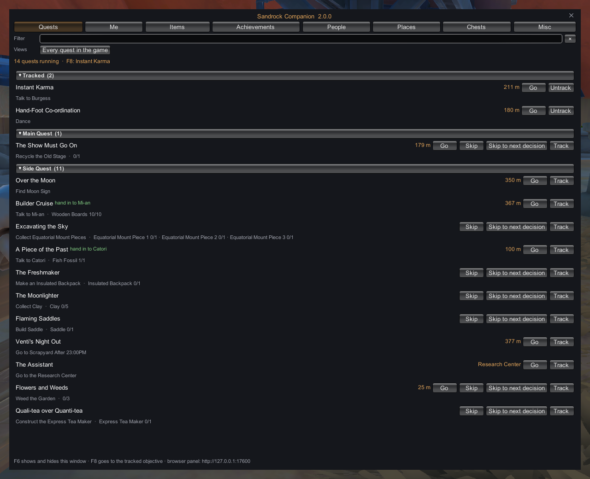
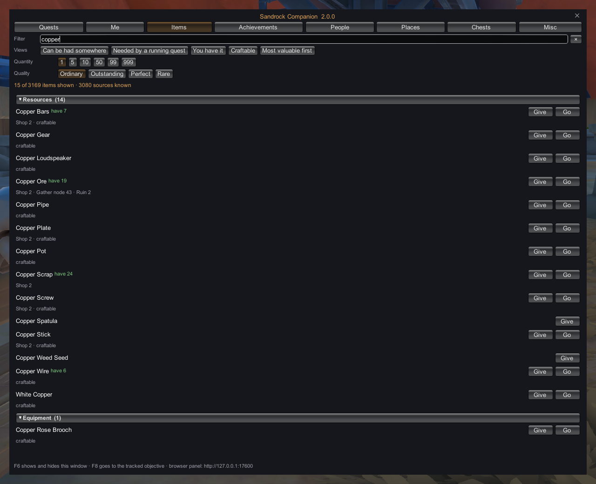
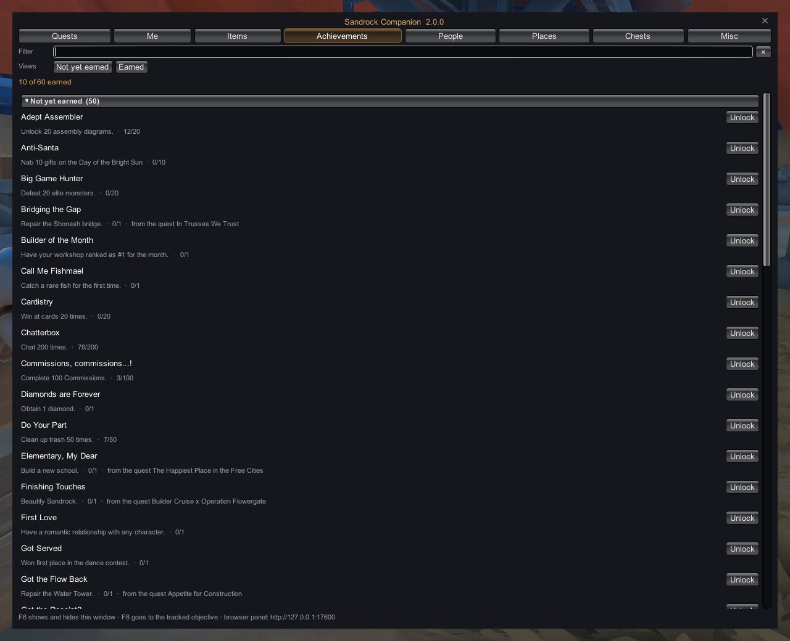
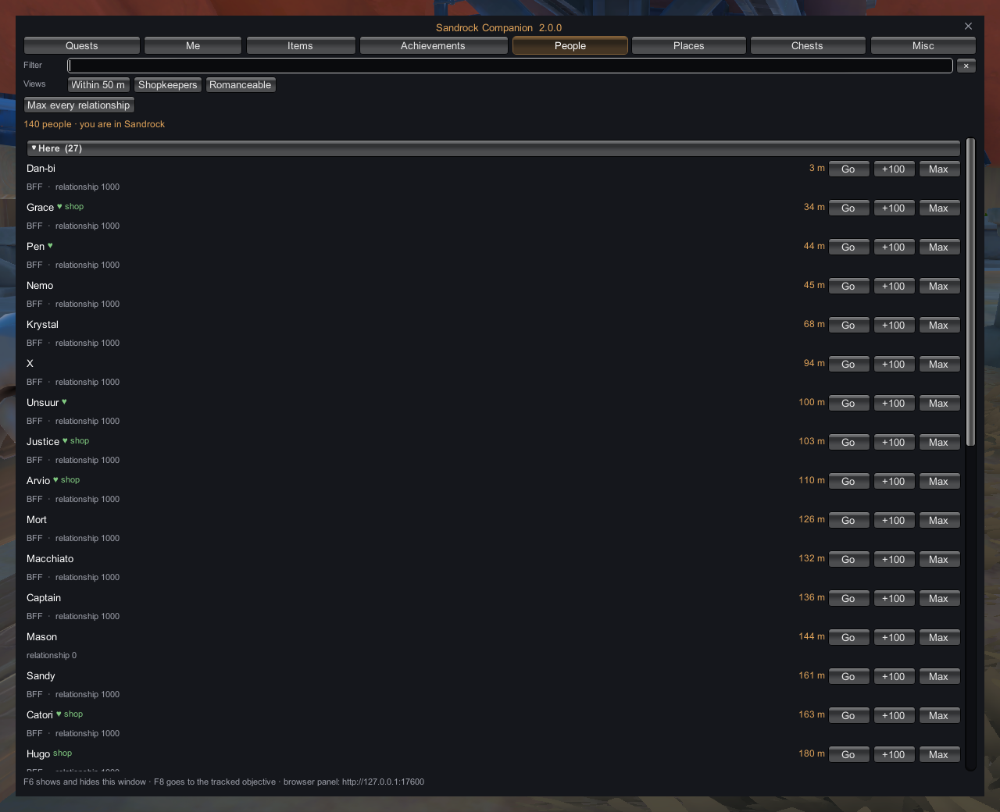
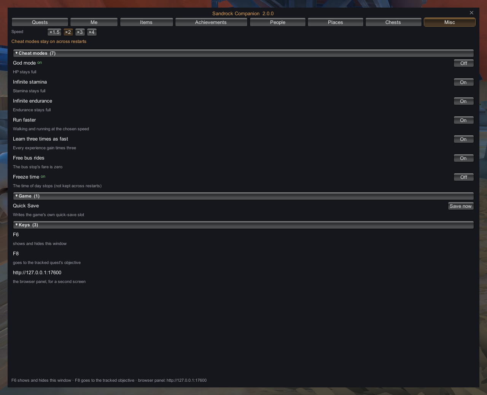

# Sandrock Companion

The full suite for **My Time at Sandrock**, in one window inside the game (**F6**) or a control panel on a second screen. **Quests**: go straight to your current objective or the person it is handed in to, and skip a step's busywork (the items, the kills, the counts) up to the next conversation. **Items**: give yourself any item at any quality, or go to where one can be had: the shop that sells it, the gather node that drops it, the chest that holds it, the ruin it is dug in, your machine that makes it. **Achievements**: every Steam achievement with your earned state, progress and the quest that grants it, and unlock any of them. Then your stats, level and money, seven cheat modes, and every person, place and chest. The conversations and their choices stay yours: the mod never picks one.

Also on Nexus Mods: https://www.nexusmods.com/mytimeatsandrock/mods/173

| | |
|---|---|
|  |  |
|  |  |

> **Single-player only.** The multiplayer client's launch integrity check rejects the mod; don't install it there.

## Features

- **Quests**: every running quest with its current step and what it still needs. **Go** to its marker: a person, a spot, a building (inside it, through the door the game would use); each press moves to the next marker. **Skip** does the step's busywork through the step's own bookkeeping: the missing items go into your bag at the quality asked for, kill and count steps run to their totals. **Skip to next decision** then takes you to the person it is handed in to and stops at the conversation. **Track** any quest. A view of every quest in the game, with force Start (it hands the quest out the way the story would, steps and all, and plays one that has ended again) and force Finish (back up your save first), and the side events the game keeps no quest name for (Logan's shave, the post-marriage barbecues and walks), each by who it involves and the line it opens with, with force Start.
- **Items**: every item in the game's own categories. **Give** any quantity (up to 999) at any quality. **Go** to where one can be had, nearest first, each press the next place: shops, gather nodes, unopened chests, ruin entrances, your own machines. Views: can be had somewhere, needed by a running quest, you have it, craftable, most valuable first.
- **Achievements**: every achievement in the game's table, earned in this save and on Steam, with progress from the game's own statistics and the quest that grants it. **Unlock** goes through the game's own call: the save records it, Steam gets it, its reward is paid.
- **Me**: HP, stamina and endurance (refill one or all), level with XP added through the game, Gols up to +100,000 at a time, and the special currencies.
- **Cheat modes**: God mode, Infinite stamina, Infinite endurance, Run faster (×1.5 to ×4), Learn three times as fast, Free bus rides, Freeze time. Each one on or off; they stay on across restarts. **Quick Save** at any time the game allows.
- **People**: everyone in the game by the scene they are in, nearest first, with relationship, **Go**, +100 and Max; views for within 50 m, shopkeepers and romanceable.
- **Places**: bus stops, ruins, buildings, shops, workshop, fishing spots and doors, by the names the game's own map gives them; **Mark** and **Back**; Go to any X/Z.
- **Chests**: every chest by scene, opened or not, with what it can hold; the game's own chest icons on the map with one switch.
- **F8** goes to the tracked quest's objective.
- Every jump moves you the way the game does (the bus stop's fade, a door's scene load), lands on the ground, and never into a ruin or a locked building. **Back** undoes the last one.
- **Languages**: Follows your game's language setting, including a switch made mid-game. The Companion's own words are in English, Chinese, French and German; a game set to any other language gets English. Names of people, places, items and quests come from the game's own text, achievements from Steam's.

## Install

**Installer**: download **`Sandrock-Companion-2.2.0-setup.exe`** from the [latest release](../../releases/latest) and run it. On its **Setup** tab, click **Install / Update**: it finds the game through Steam (or paste the game folder) and installs BepInEx and the plugin. Then start My Time at Sandrock in single-player and press **F6**; the app shows the control panel while the game runs. Windows may warn about an unknown publisher: More info > Run anyway.

**Manual**: download **`sandrock-companion-v2.2.0.zip`** from the same release or the [Nexus Files tab](https://www.nexusmods.com/mytimeatsandrock/mods/173?tab=files). It is laid out like the game folder: extract all of it into the folder that holds `Sandrock.exe` (in Steam: right-click My Time at Sandrock → Manage → Browse local files).

| In the zip | Goes to | What it is |
|---|---|---|
| `winhttp.dll`, `doorstop_config.ini`, `.doorstop_version`, `changelog.txt` | `<game>\`, next to `Sandrock.exe` | BepInEx 5.4.23.5 loader |
| `BepInEx\core\` (all files) | `<game>\BepInEx\core\` | BepInEx itself |
| `BepInEx\plugins\SandrockTrainer\SandrockTrainer.dll` | `<game>\BepInEx\plugins\SandrockTrainer\` | the Sandrock Companion plugin |
| `BepInEx\plugins\SandrockTrainer\panel.html` | same folder | the browser control panel |
| `BepInEx\plugins\SandrockTrainer\locations.json`, `ruins.json`, `achievements.json`, `events.json` | same folder | named places, ruin entrances, achievement names, side events |

Already have BepInEx 5.4.x (x64)? Copy only `BepInEx\plugins\SandrockTrainer\`. Start the game in single-player, load a save and press **F6**, or open **http://127.0.0.1:17600** in a browser on the same PC (another program on that port? Set `Port` under `[Server]` in `BepInEx\config\stephen.sandrock.trainer.cfg`; the app reads it too). `Sandrock Companion INSTALL.txt` in the zip lists every file; deleting them uninstalls it.

**Updating from 1.x**: the plugin keeps its folder, so Install / Update or the zip replaces it in place.

## Compatibility

Built and tested on Steam build **18623106**. A game update may need a rebuilt plugin. Test on a copy of your save first; Unlock on the Achievements tab is permanent on your Steam account.

## Also by me

- **KCD Companion** for Kingdom Come: Deliverance: go where the quest points, skip busywork up to the next decision, items, achievements, cheat modes. [GitHub](https://github.com/registered2nd/kcd-companion) · [Nexus Mods](https://www.nexusmods.com/kingdomcomedeliverance/mods/2406)
- **KCD2 Companion** for Kingdom Come: Deliverance II: go where the quest points, skip busywork up to the next decision, items, achievements, cheat modes. [GitHub](https://github.com/registered2nd/kcd2-companion) · [Nexus Mods](https://www.nexusmods.com/kingdomcomedeliverance2/mods/3812)

## Credits

Original mod code, loaded by BepInEx 5 (LGPL-2.1) with Harmony (MIT). Not affiliated with Pathea Games.
